<p align="center">
  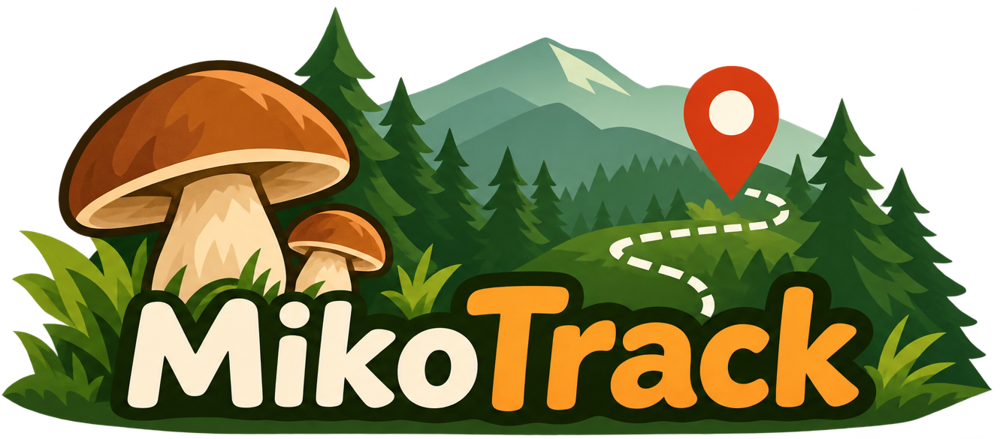
</p>

<h1 align="center">MycoTrack</h1>

<p align="center">
  <a href="README.md">English</a> · <b>Català</b><br/>
  📥 <a href="install.ca.md"><b>Guia d'instal·lació</b></a> — instal·la l'APK a qualsevol mòbil amb Android 8.0+, sense botiga
</p>

MycoTrack és una aplicació nativa per a Android per registrar, consultar i analitzar
sortides boletaires al bosc. Funciona com un gravador de rutes amb GPS amb un mapa a
pantalla completa, fotografies amb etiquetatge geogràfic, un perfil d'altimetria
sincronitzat, estadístiques en temps real, historial de sortides amb reproducció, i
exportació de dades i d'imatges.

Tot es desa localment al dispositiu. L'aplicació **no** utilitza l'SDK de Google Maps, no
requereix cap dependència de Google Play Services i no necessita cap clau d'API, compte ni
subscripció.

## Instal·lació

Vols provar-la? L'aplicació es distribueix des d'aquest repositori: descarrega un APK
signat de l'[última publicació](https://github.com/elricdog/MycoTrack/releases) i
instal·la'l a qualsevol telèfon o tauleta amb Android 8.0+, fins i tot sense Google Play
Services. Les instruccions pas a pas (permisos, tria de l'APK adequat, instal·lació manual,
actualitzacions i solució de problemes) són a la **[guia d'instal·lació](install.ca.md)**.

## Suporta el projecte

El MycoTrack és gratuït, de codi obert i sense publicitat. Si t'agrada i vols donar suport
al seu desenvolupament, pots convidar l'autor a un cafè:

[](https://paypal.me/elricdog)
[](https://github.com/sponsors/elricdog)

## Captures de pantalla

| **Mapa i gravació** — mapa a pantalla completa amb la posició en viu, la ruta que es va dibuixant i el panell d'estadístiques en temps real; *Finalitza mantenint premut* acaba la sortida. | **Perfil d'altimetria** — altitud contra distància, sincronitzat amb el mapa: toca la gràfica per moure el marcador, els punts de foto es situen sobre la ruta. |
|---|---|
| 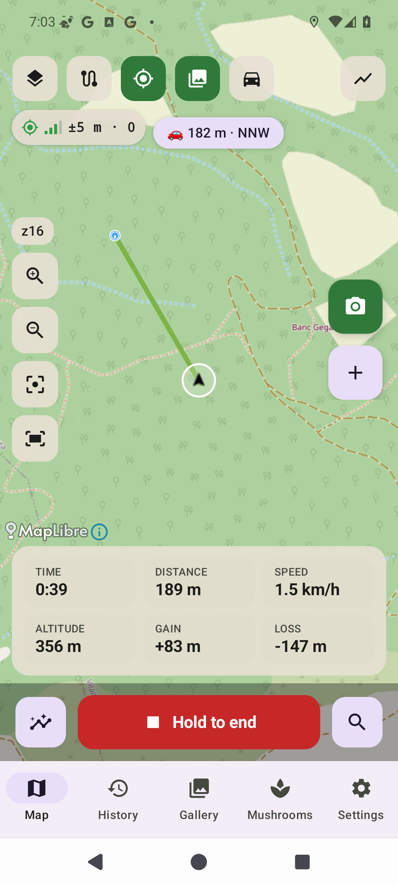 | 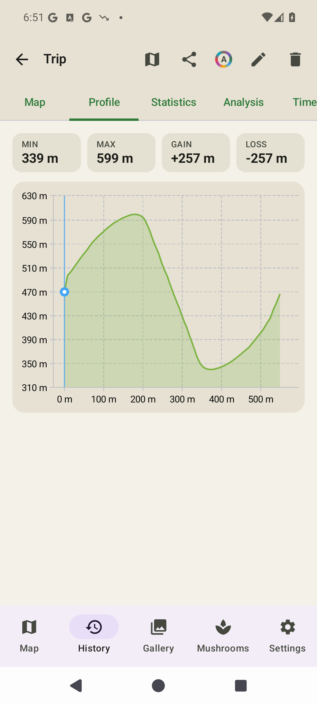 |

| **Capes** — canvia entre OpenStreetMap, el mapa topogràfic de l'ICGC, l'ortofoto i la vista híbrida, afegeix àrees offline i activa les capes d'hàbitat (pluviositat, orientació de vessants, tipus d'arbres, sòl). | **Historial** — cada sortida registrada amb distància, durada, desnivell i nombre de fotos; cerca, filtra i assigna un color de ruta propi a cada sortida. |
|---|---|
| 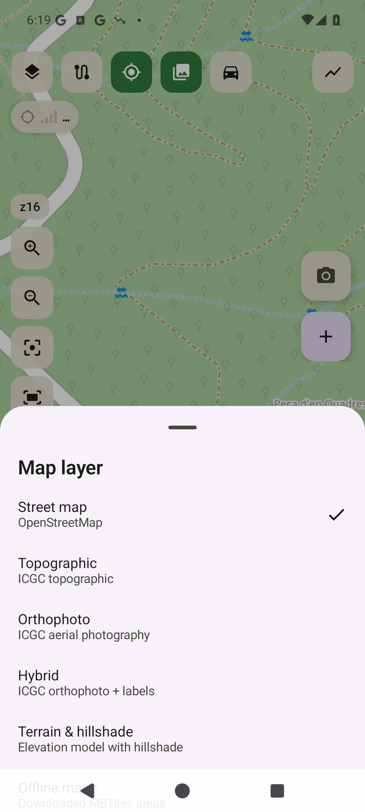 | 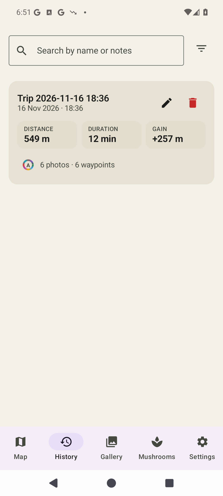 |

| **Repàs de la sortida** — mapa amb la ruta gravada, perfil d'altimetria, estadístiques completes, notes i reproducció animada; exporta o torna a carregar la ruta al mapa principal. | **Anàlisi de la sortida** — temps en moviment vs aturat, ritme, punt més llunyà, detecció de circuit, troballes per hora i per alçada, llum de dia restant i la teva classificació personal. |
|---|---|
| 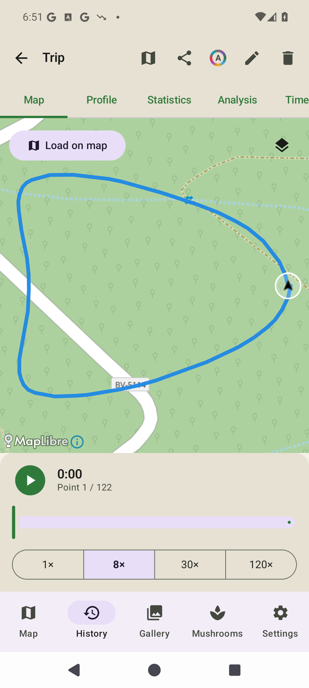 | 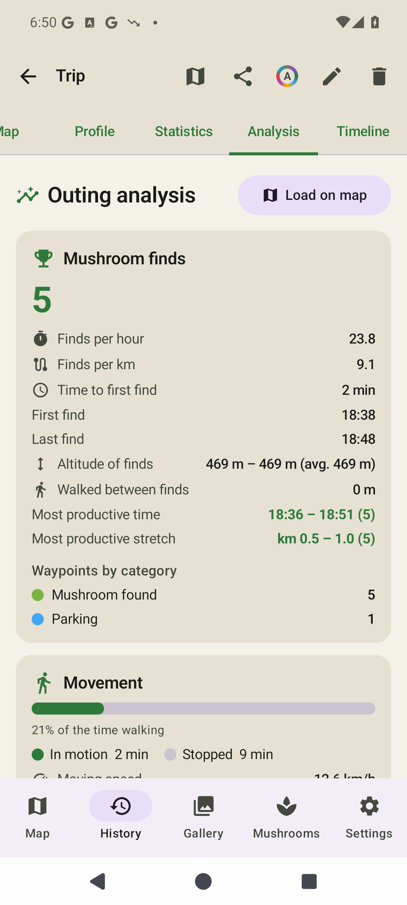 |

| **Galeria** — tots els punts d'interès amb etiquetatge geogràfic com a mosaic de fotos (o de color de categoria quan no tenen foto); mostra'n un al mapa, esborra'l, comparteix-lo o exporta'l amb la seva ubicació. | **Guia de bolets** — enciclopèdia offline dels bolets més populars de Catalunya: cerca, filtre *De temporada ara* i fitxes per espècie. |
|---|---|
| 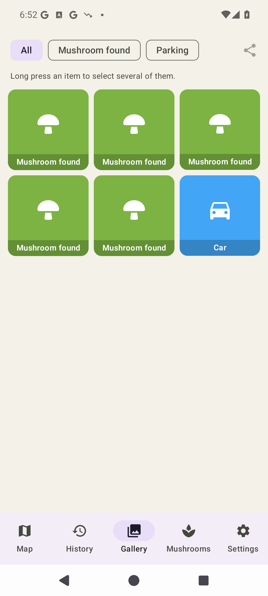 | 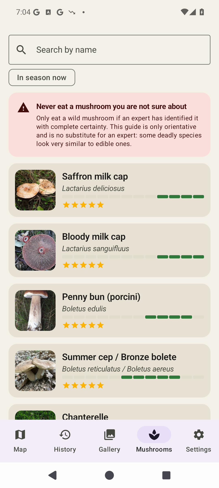 |

| **Fitxa de l'espècie** — cocció, hàbitat, calendari de temporada, confusions perilloses, galeries de fotos i una cerca d'hàbitat *On en puc trobar?* que pinta al mapa les zones probables al teu voltant. | **Configuració** — idioma, tema, unitats, sons i alertes, gestor de mapes offline, diagnòstic de GPS i sensors i permisos. |
|---|---|
| 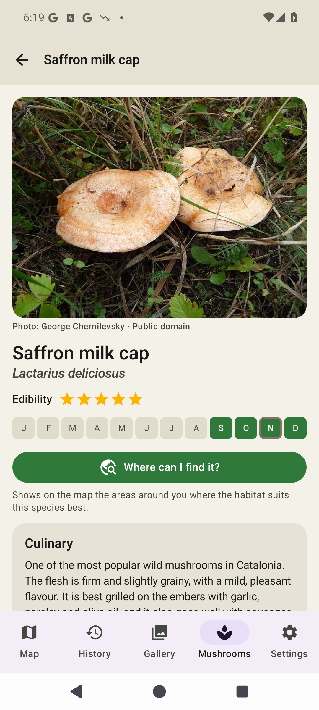 | 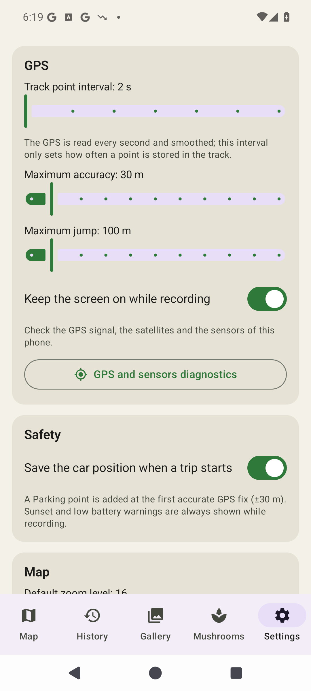 |

| **Pluviositat, últims 3 dies** — la capa d'hàbitat *Pluviositat* pinta la pluja acumulada a la finestra triada (3 / 7 / 15 / 30 dies) a partir dels models gratuïts d'Open-Meteo: el blau és humit, el transparent és sec. Tria la finestra sota l'interruptor; la llegenda mostra la rampa de colors. | **Pluviositat, últims 30 dies** — la mateixa capa sobre un mes: destaquen les valls que van rebre les pluges de la tardor, i prement un punt amb pressió llarga surt l'acumulació exacta de les quatre finestres amb l'etiqueta sec / humit / molt humit. Pluja fa pocs dies + sòl i arbres adequats és el senyal clàssic de bolets. |
|---|---|
| 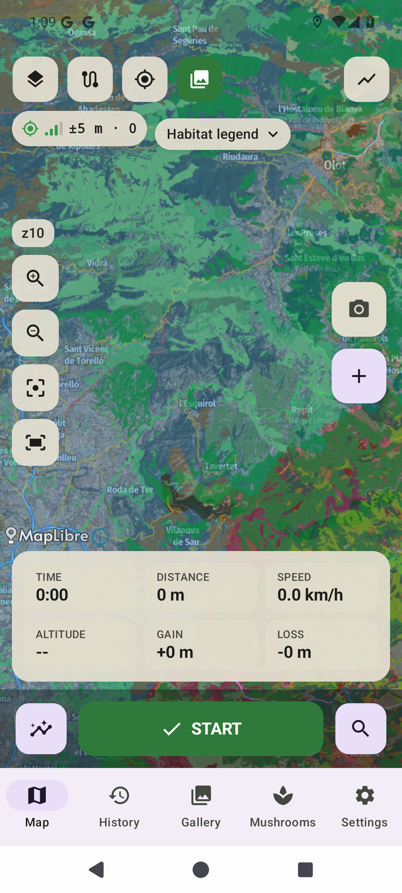 | 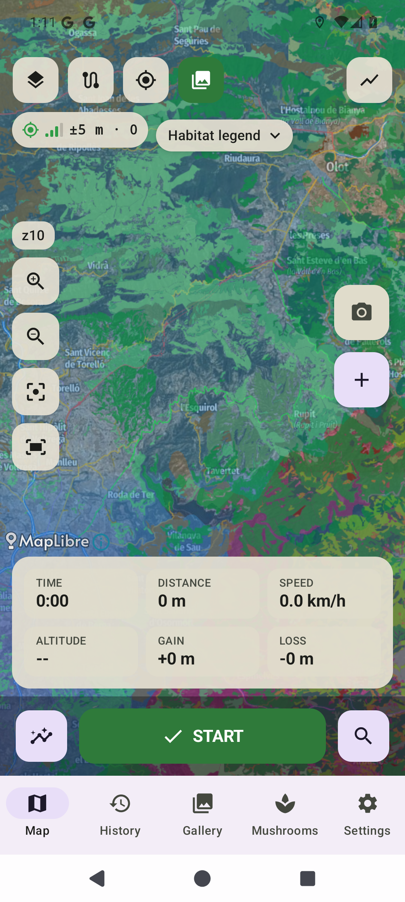 |

---

## 1. Visió general de les funcionalitats

| Àmbit | Què fa |
| --- | --- |
| Mapa | Mapa MapLibre a pantalla completa, posició en directe, ruta en directe, rutes anteriors superposades, marcadors de fotografies i selector de capes |
| Gravació | Controls *Inici* / *Fi*, servei en primer pla que continua gravant amb la pantalla apagada, persistència progressiva, recuperació després d'un bloqueig |
| Capes | OpenStreetMap, topogràfic ICGC, ortofoto ICGC, híbrida ICGC, terreny + ombreig i MBTiles offline |
| Capes d'hàbitat | Overlays commutables sobre qualsevol mapa base: pluviositat (pluja acumulada els últims 3, 7, 15 o 30 dies, a partir dels models gratuïts d'Open-Meteo), orientació de vessants (nord / sud / est-oest amb tramat, calculat al dispositiu a partir de les tessel·les d'altitud), espècies dominants d'arbres (Mapa Forestal de Espanya, MITECO) i substrat del sòl (roca àcida / bàsica, mapa litològic de l'IGME), amb una llegenda al mapa on cada classe es pot mostrar o amagar; i les *zones probables* d'una espècie de la guia al voltant de l'usuari, puntuades a partir de les tres capes |
| Perfil d'altimetria | Gràfica Vico, distància a l'eix horitzontal, altitud a l'eix vertical, toc per localitzar un punt al mapa, marcador de posició en directe |
| Estadístiques | Temps emprat, distància, velocitat actual / mitjana / màxima, altitud, desnivell positiu, negatiu, temps en moviment i aturat, comptadors de fotos i punts d'interès |
| Fotografies | Càmera dins de l'aplicació (CameraX), punts d'interès amb geoposició, descripció i categoria editables |
| Rutes superposades | Qualsevol nombre de sortides anteriors dibuixades sobre el mapa amb una funda fosca i línies discontínues animades «formigues», cadascuna amb el seu color (automàtic o triat a l'historial) i el seu nom en una etiqueta de mida constant, activades i desactivades des del botó *Rutes*. El botó opcional *Vés a la ruta* enquadra cada ruta superposada per torns i després torna a la posició de l'usuari |
| Premsa llarga al mapa | Marca el punt i obre un menú amb les coordenades i la distància: *Crea un punt aquí* (a la sortida que es grava, o a una sortida anterior triada), *Vés-hi* (indicacions a peu a Google Maps, o el navegador / qualsevol aplicació `geo:`) i *Copia les coordenades* |
| Cerca de llocs | El botó de cerca a la dreta d'*Inici* obre un full per trobar un lloc per nom (Nominatim, resultats amb tipus, localitat i distància), anar a unes coordenades introduïdes (decimals o graus-minuts-segons) o respondre *On sóc?* (adreça, municipi, comarca, província, codi postal, element proper, coordenades i altitud, amb còpia i compartició). El lloc triat s'enquadra i es marca; el botó de xinxeta també obre el menú de premeu llarg allà. El botó es pot amagar a la configuració |
| Alarmade proximitat | Un so, una vibració i una notificació quan l'usuari s'apropa a 15–100 m d'un punt d'interès d'una sortida superposada. Funciona amb la pantalla apagada mentre es grava, i mentre el mapa és visible en cas contrari |
| Registre ràpid | Una acció *🍄 Bolet trobat* a la notificació de gravació desa un punt a la posició actual sense obrir l'aplicació, també des de la pantalla de bloqueig, amb una vibració curta de confirmació. Les descripcions dels punts es poden dictar amb el reconeixement de veu del sistema (botó de micròfon) |
| Tornar al cotxe | Un punt *Cotxe* es desa a la primera correcció precisa (±30 m) d'una sortida nova (es pot desactivar a *Configuració → Seguretat*). El botó *Tornar al cotxe* del mapa i un xip de distància/direcció obren el punt del cotxe amb la distància i la direcció en directe; sense gravació, s'ofereix el cotxe de l'última sortida durant 12 h |
| Alertes de seguretat | Durant la gravació: notificacions 60 i 20 minuts abans de la posta de sol (algoritme NOAA, calculat al dispositiu per a la posició actual) i quan la bateria baixa al 20 % i al 10 %, amb la distància al cotxe i el temps de tornada caminant estimat (4 km/h, factor 1,3 de camí) |
| Diagnòstic de GPS i sensors | *Configuració → GPS* o la xips d'estat del GPS al mapa: qualitat del senyal (apagat / buscant / deficient / regular / bo / excel·lent), última correcció en brut (precisió, altitud, velocitat, rumb, cadència), satèl·lits per constel·lació amb mapa celeste i gràfica C/N0, brúfol, inclinòmetre amb nivell de bombolla, sensors de moviment i d'entorn, bateria i comprovacions d'estalvi d'energia, i una acció *Copia l'informe* |
| Historial | CRUD complet de sortides, cerca per nom i notes, filtres per distància, durada, alçada, fotos i data. Cada sortida pot tenir el seu propi color de ruta per al mapa (12 colors d'alt contrast o *Automàtic*) des del punt de color de la llista o de la fitxa de la sortida |
| Repàs | Mapa, perfil d'altimetria, estadístiques detallades, cronologia, notes i reproducció animada de la ruta amb control de velocitat. *Carrega al mapa* (botó de mapa de la barra superior o del mapa del repàs) superposa la sortida al mapa principal i emmarca tota la ruta |
| Anàlisi de la sortida | Pestanya *Anàlisi* de la fitxa de la sortida: temps en moviment vs aturat, velocitat de desplaçament, ritme, velocitat màxima filtrada ( pics de GPS ignorats), aturada més llarga; rang d'altitud, ascens/descens i pujada més pronunciada; distància màxima des de l'inici i des del cotxe, detecció de circuits; bolets per categoria, per hora i per km, temps fins a la primera troballa, rang d'altitud de les troballes, franja horària més productiva i tram de 500 m amb gràfiques de barres per temps i alçada; llum de dia restant al final (sortida/posta de sol); rànquing entre les sortides de l'usuari per troballes, distància i durada |
| Exportació | GPX, GeoJSON, KML, CSV, paquet ZIP, imatges PNG del mapa, perfils d'altimetria i informes visuals de la sortida |
| Galeria | Tots els punts d'interès: fotografies, i punts sense foto com a mosaics del color de la categoria amb la seva icona. *Mostra al mapa* superposa la sortida i centra el mapa en el punt; un o diversos punts (premsa llarga per seleccionar) es poden esborrar amb les fotos després d'una confirmació |
| Exportació de la galeria | Comparteix les fotografies, desa-les a `Pictures/MikoTrack` o empaqueta-les en un ZIP amb les seves ubicacions (GeoJSON + CSV) |
| Offline | Àrees descarregades d'avançament com a MBTiles servides des d'un servidor de tessel·les de bucle tancat |
| Idiomes | Anglès, català i castellà. Tria a *Configuració → Idioma* o, a Android 13+, a la configuració d'idiomes per aplicació del sistema |
| Guia de bolets | Pestanya *Bolets*: minicopèdia offline de 34 bolets comestibles populars de Catalunya, amb foto, cocció, hàbitat, calendari de temporada, confusions perilloses i un avís de seguretat. Cerca i filtre *De temporada ara*. Galeria de fotos addicional per espècie i fotos de les confusions perilloses (marc vermell, insígnia *Tòxic* / *No comestible*); cada foto s'obre en un visor a pantalla completa amb lliscament, zoom amb pinça / doble toc, peu de foto, crèdit i enllaços de llicència, compartició i desadesa a *Pictures/MikoTrack*. Un gràfic plegable *Arbres i sòls preferits* mostra l'afinitat de l'espècie per a cada tipus de bosc, terreny obert, substrat del sòl i orientació del pendent (els valors utilitzats per a les zones probables). Contingut a `app/src/main/assets/mushrooms` |

## 2. Pila tecnològica

| Aspecte | Elecció |
| --- | --- |
| Llenguatge | Kotlin 2.2.0 |
| IU | Jetpack Compose + Material Design 3 |
| Arquitectura | MVVM amb un contenidor de dependències manual (`core/AppContainer`) |
| Mapes | MapLibre Native for Android 13.1.0 (OpenStreetMap, ICGC, offline) |
| Localització | `android.location.LocationManager` (sense proveïdor fusionat, sense Play Services) |
| Fons | Servei en primer pla amb el tipus `location` + WorkManager |
| Persistència | Room 2.7.2 (SQLite) + Jetpack DataStore per a les preferències |
| Gràfiques | Vico 2.1.4 |
| Asincronia | Kotlin Coroutines i Flow |
| Mapes offline | MBTiles 1.3, servits per un servidor HTTP de bucle tancat |

## 3. Muntatge de l'aplicació

Requisits:

* JDK 17 o superior
* Android SDK amb la plataforma 36 i eines de muntatge 36.x

```bash
# La ubicació de l'SDK, si ANDROID_HOME no està definida
echo "sdk.dir=/path/to/Android/Sdk" > local.properties

./gradlew assembleDebug        # construeix l'APK de depuració
./gradlew test                 # executa les proves unitàries
./gradlew installDebug         # instala en un dispositiu connectat
```

L'aplicació **no necessita cap clau d'API**. `local.properties` és l'única configuració local.

### Signatura de les publicacions

Les compilacions de publicació se signen automàticament quan hi ha un fitxer
`keystore.properties` al costat del `settings.gradle.kts` arrel; sense ell, els APK de
publicació queden sense signar. Aquest fitxer és al `.gitignore` i no s'ha de commatar mai:

```properties
storeFile=mikotrack-release.keystore
storePassword=…
keyAlias=mikotrack-release
keyPassword=…
```

Crea el keystore un sol cop amb (`keytool` ve amb el JDK):

```bash
keytool -genkeypair -keystore mikotrack-release.keystore -alias mikotrack-release \
    -keyalg RSA -keysize 2048 -validity 10950 -storepass … -dname "CN=MycoTrack, …"
```

Fes una còpia de seguretat segura del `mikotrack-release.keystore` i de la contrasenya:
sense ells és impossible publicar actualitzacions que reemplacin una versió ja installed.

```bash
./gradlew assembleRelease      # APKs signats, a app/build/outputs/apk/release/
```

### Permisos

| Permís | Per què es necessita |
| --- | --- |
| `ACCESS_FINE_LOCATION` / `ACCESS_COARSE_LOCATION` | Llegir la posició del GPS |
| `ACCESS_BACKGROUND_LOCATION` | Continuar la gravació amb la pantalla apagada |
| `FOREGROUND_SERVICE` / `FOREGROUND_SERVICE_LOCATION` | El servei en primer pla de gravació |
| `POST_NOTIFICATIONS` | La notificació de gravació en curs |
| `CAMERA` | Fer les fotografies amb etiquetatge geogràfic a l'aplicació |
| `INTERNET` / `ACCESS_NETWORK_STATE` | Descarregar tessel·les de mapa i dades d'altitud |

## 4. Fonts de mapes i atribució

Les capes base es descriuen a `maps/MapLayer.kt` i es poden reemplaçar o ampliar sense
tocar la resta de l'aplicació.

| Capa | Font | Atribució |
| --- | --- | --- |
| Mapa de carrers | `tile.openstreetmap.org` | © Col·laboradors d'OpenStreetMap (ODbL) |
| Topogràfic | WMTS `mapa-base` de l'ICGC, `topografic` | © Institut Cartogràfic i Geològic de Catalunya |
| Ortofotografia | WMTS `mapa-base` de l'ICGC, `orto` | © Institut Cartogràfic i Geològic de Catalunya |
| Híbrida | WMTS `mapa-base` de l'ICGC, `orto-hibrida` | © Institut Cartogràfic i Geològic de Catalunya |
| Terreny i ombreig | Tessel·les d'altitud Terrarium | © Mapzen / Col·laboradors d'OpenStreetMap |
| Offline | MBTiles descarregats per l'aplicació | Desats al dispositiu |

La cerca de llocs utilitza el geocodificador Nominatim (`nominatim.openstreetmap.org`,
© col·laboradors d'OpenStreetMap), com a màxim una consulta per segon, només quan
l'usuari envia una cerca.

### Capes d'hàbitat

Quatre capes opcionals (*Capes → Capes d'hàbitat*) es dibuixen sobre qualsevol mapa base
i per sota de les rutes, els punts i la posició, de baix a dalt: pluviositat, sòl, tipus
d'arbres i orientació de vessants (i, a dalt de tot, les zones probables d'una espècie).
Cal connexió a internet; offline queden buides.

La capa de **pluviositat** pinta, en blaus que degraden a porpra, els mil·límetres
acumulats els últims **3, 7, 15 o 30 dies** (es tria amb unes opcions sota l'interruptor),
per veure d'un cop d'ull quines valls van rebre la pluja i quines van quedar seques: la
pluja d'uns dies enrere és el principal desencadenant de la sortida dels bolets. En
activar-la, l'aplicació descarrega la pluja diària d'una quadrícula de 999 punts que cobreix
Catalunya amb marge (0,1°, la resolució del model) a l'API gratuïta d'
[Open-Meteo](https://open-meteo.com/) (`daily=precipitation_sum`), en blocs de 100 punts
separats 1,2 s amb reintent progressiu davant respostes 429, i la desa a la base de dades
local (`maps/RainRepository.kt`, taules `rain_daily` i `rain_meta`). La descàrrega cobreix
els 31 dies acabats i s'actualitza com a màxim cada 12 hores; com que cada valor es desa
amb el seu dia, les quatre finestres es calculen al dispositiu sense tornar a preguntar
(`maps/RainGrid.kt`). El servidor local pinta cada tessel·la interpolant bilinealment els
sums de la finestra (`maps/RainTileProvider.kt`), i la rampa de colors segueix la
*intensitat* (mm per dia) i no el total, així una sola rampa s'entén bé a cada finestra:
3 mm en 3 dies és pluja intensa, 3 mm en 30 dies és xerinola. La finestra (`w`) i la
versió de la descàrrega (`v`) viatgen a l'URL, així una descàrrega nova recarrega les
tessel·les. Prement un punt amb pressió llarga, el full del punt mostra l'acumulació exacta
de les quatre finestres i una etiqueta qualitativa (sec / humit / molt humit / encharcat).
Dades © Open-Meteo (models ICON / ECMWF, CC BY 4.0); la quadrícula del model és de ~7 km,
de manera que és una orientació general, no una previsió puntual.

## 5. Mapes sense connexió

Les àrees descarregades són fitxers MBTiles (SQLite amb una taula `tiles`, convenció de
files TMS). `maps/LocalTileServer` exposa les tessel·les desades mitjançant un petit
servidor HTTP lligat a `127.0.0.1`, i MapLibre les llegeix mitjançant una font ràster que
apunta a aquest servidor. El resultat és un mapa completament offline que no depèn de cap
servei extern i que es pot esborrar en qualsevol moment des de
*Configuració → Mapes sense connexió*.

### Paquets incorporats

Els dos paquets de Catalunya **no es desen en aquest repositori** (són massa grans per a
GitHub). Viuen a `app/offline-assets/offline/`, que és al `.gitignore` i està connectat
com a directori d'assets addicional només per a les compilacions de **depuració**, de
manera que un APK de depuració els incorpora i els copia a l'emmagatzematge privat en la
primera arrencada: l'ortofoto de l'ICGC (zoom 10–13, tessel·les JPEG de 256 px) i el mapa
topogràfic de l'ICGC (zoom 10–12, tessel·les de 512 px). Els APK de publicació no els
contenen i les àrees de mapes offline s'han de descarregar al dispositiu; una compilació
de publicació simplement omet sembra els paquets que falten. Per (re)crear els paquets,
fes servir els scripts de `tools/` (Python 3 i Pillow):

```bash
pip install pillow
python tools/build_offline_pack.py --layer ORTO --min-zoom 10 --max-zoom 13 \
    --out app/offline-assets/offline/catalonia_ortho.mbtiles
python tools/finalize_offline_pack.py app/offline-assets/offline/catalonia_ortho.mbtiles --tile-size 256

python tools/build_offline_pack.py --layer TOPO --min-zoom 10 --max-zoom 12 \
    --out app/offline-assets/offline/catalonia_topo.mbtiles
python tools/finalize_offline_pack.py app/offline-assets/offline/catalonia_topo.mbtiles --tile-size 512
```

El muntatge es pot reprendre. El pas de finalització fusiona el registre d'escriptura
antecipada al fitxer, de manera que no queden fitxers `-wal`/`-shm` a l'APK. Si el rang de
zoom o el nombre de tessel·les canvien, actualitza `OfflineMapManager.BUNDLED_PACKS` en
conseqüència.

## 6. Model de dades

| Taula | Columnes |
| --- | --- |
| `trips` | `id`, `name`, `startTime`, `endTime`, `durationMillis`, `distanceMeters`, `elevationGain`, `elevationLoss`, `minAltitude`, `maxAltitude`, `notes`, `status`, `photoCount`, `waypointCount`, `lastUpdated` |
| `track_points` | `id`, `tripId`, `latitude`, `longitude`, `altitude`, `accuracy`, `speed`, `bearing`, `timestamp` |
| `waypoints` | `id`, `tripId`, `latitude`, `longitude`, `altitude`, `timestamp`, `description`, `category`, `imagePath` |
| `waypoint_categories` | `id`, `name`, `color`, `symbol`, `builtIn` |
| `offline_areas` | `id`, `name`, `layerId`, `filePath`, límits, rang de zoom, `tileCount`, `sizeBytes`, `createdAt` |
| `rain_daily` | latitud, longitud i dia (PK, en micro graus / dies d'època) i `millimeters` de pluja d'aquell dia a cada node de la quadrícula |
| `rain_meta` | instant de la descàrrega i geometria de la quadrícula (origen, pas, files, columnes) |

Les claus foranes utilitzen `ON DELETE CASCADE`, de manera que esborrar una sortida també
en elimina el track i els punts; les fotografies s'esborren del sistema de fitxers per
`ImageStore`.

## 7. Dependències de tercers i llicències

Totes les dependències són lliures i de codi obert.

| Dependència | Versió | Llicència |
| --- | --- | --- |
| Jetpack Compose / Material 3 | BOM 2025.06.01 | Apache 2.0 |
| Jetpack Navigation Compose | 2.9.5 | Apache 2.0 |
| Jetpack Lifecycle | 2.9.4 | Apache 2.0 |
| Jetpack Activity Compose | 1.10.1 | Apache 2.0 |
| Jetpack DataStore | 1.1.7 | Apache 2.0 |
| Jetpack WorkManager | 2.10.5 | Apache 2.0 |
| Room | 2.7.2 | Apache 2.0 |
| CameraX | 1.4.2 | Apache 2.0 |
| ExifInterface | 1.4.1 | Apache 2.0 |
| MapLibre Native for Android | 13.1.0 | BSD-2-Clause |
| Connectors MapLibre Android | 4.0.0 | BSD-2-Clause |
| Vico | 2.1.4 | Apache 2.0 |
| Coil | 2.7.0 | Apache 2.0 |
| Kotlin Coroutines | 1.10.2 | Apache 2.0 |
| kotlinx.serialization | 1.9.0 | Apache 2.0 |
| Robolectric (només proves) | 4.14.1 | Apache 2.0 |
| JUnit (només proves) | 4.13.2 | EPL 1.0 |

### Crèdits de les fotografies

Les fotografies de la guia de bolets provenen de Wikimedia Commons i s'utilitzen segons
llicències lliures (domini públic, CC BY i CC BY-SA). L'autor, la llicència i un enllaç a
l'arxiu original de cada fotografia es mostren a sota, a la fitxa de cada espècie, i
estan llistats a `app/src/main/assets/mushrooms/species.json`. Les imatges principals
s'han redimensionat a 800 px o menys, i les fotos de la galeria i de les confusions
(`<species>_gN.jpg`, `la_<species>.jpg`) a 720 px i uns 90 KB o menys.

## 8. Proves

Les proves unitàries cobreixen les parts que porten la lògica de domini i es poden
verificar sense dispositiu:

* `GeoUtilsTest` – distàncies i rumbos.
* `TripStatsCalculatorTest` – distància, desnivell positiu i negatiu, temps en moviment,
  el perfil d'altimetria i la interpolació de l'altitud.
* `GpsTrackSmootherTest` – el suavitzat i el rebuig d' valors erronis del GPS.
* `WaypointDistanceCalculatorTest` – distància, direcció i distància al llarg de la ruta a un punt.
* `ProximityMonitorTest` – quan sona l'alarma de proximitat i quan es rearma.
* `SunCalculatorTest` i `TripSafetyTest` – hores de posta de sol i els avisos de posta / bateria.
* `GpsQualityTest` – la qualificació del senyal GPS.
* `ExporterTest` – els documents GPX, GeoJSON, KML i CSV es tornen a parsejar com a XML / CSV.
* `TileMathTest`, `MbtilesStoreTest`, `OfflineMapPackTest` – càlcul de tessel·les, fitxers MBTiles i
  els paquets incorporats.
* `AspectClassifierTest` – orientació del pendent (aspecte) i les seves classes nord / sud / neutre / pla.
* `RainGridTest` i `RainScaleTest` – les finestres d'acumulació, el mostreig bilineal i el pintat de tessel·les de la quadrícula de pluja, i la rampa de colors i les bandes d'intensitat.
* `HabitatPointInspectorTest` – anàlisi de respostes reals `GetFeatureInfo` dels mapes forestal i
  litològic, i l'orientació / pendent en un punt d'una graella d'altitud.
* `PermissionRequirementTest` – cada permís s'explica en les tres llengües.
* `MushroomCatalogTest` – les dades de la guia de bolets són completes en les tres llengües, amb fotos acreditades, amb peu de foto i llicència lliure a les galeries i fotos de confusions (consistents amb els textos de confusions) i preferències d'hàbitat vàlides.
* `CoordinateParserTest` – coordenades decimals, de graus-minuts-segons i d'hemisferi introduïdes per l'usuari.
* `GeocoderTest` – respostes de cerca / reversa de Nominatim i URLs de consulta.

```bash
./gradlew test
```

## 9. Notes i limitacions

* L'aplicació està dissenyada per al cas d'ús descrit a l'especificació: una sortida que
  es grava al bosc, es repassa dies després i s'exporta.
* El permís d'ubicació en segon pla s'ha de concedir des de la configuració del sistema a
  les versions recents d'Android; *Configuració → Permisos* enllaça a la pantalla del sistema.
* Les capes de l'ICGC cobreixen Catalunya. Fora d'aquesta zona les capes amb cobertura són
  OpenStreetMap i la de terreny.
* Una sortida gravada es desa punt a punt, de manera que una finalització inesperada no
  perd mai les dades; la pantalla del mapa ofereix reprendre la sortida interrompuda.
