<p align="center">
  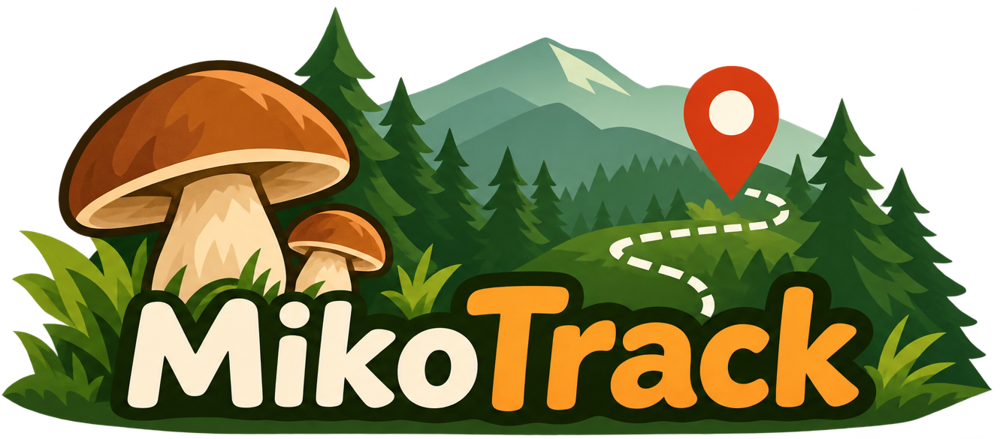
</p>

<h1 align="center">MycoTrack</h1>

<p align="center">
  <b>English</b> · <a href="README.ca.md">Català</a><br/>
  📥 <a href="install.md"><b>Install guide</b></a> — get the APK on any Android 8.0+ phone, no store needed
</p>

MycoTrack is a native Android application to record, browse and analyse mushroom foraging
trips in the forest. It works as a GPS route recorder with a full-screen map, geotagged
photographs, a synchronised elevation profile, real-time statistics, trip history with
playback, and data and image export.

Everything is stored locally on the device. The application does **not** use the Google Maps
SDK, does not require a Google Play Services dependency and does not need any API key,
account or subscription.

## Install

Want to try it? The app is distributed from this repository: download a signed APK from the
[latest release](https://github.com/elricdog/MycoTrack/releases) and install it on any
Android 8.0+ phone or tablet, even without Google Play Services. Step-by-step instructions
(permissions, choosing the right APK, sideloading, updates and troubleshooting) are in
**[install.md](install.md)** — available in [English](install.md) and [Català](install.ca.md).

## Screenshots

| **Map & recording** — full-screen map with your live position, the route being drawn and the real-time statistics panel; *Hold to end* finishes a trip. | **Elevation profile** — altitude against distance, synchronised with the map: tap the chart to move the marker, the photo dots sit on the route. |
|---|---|
| 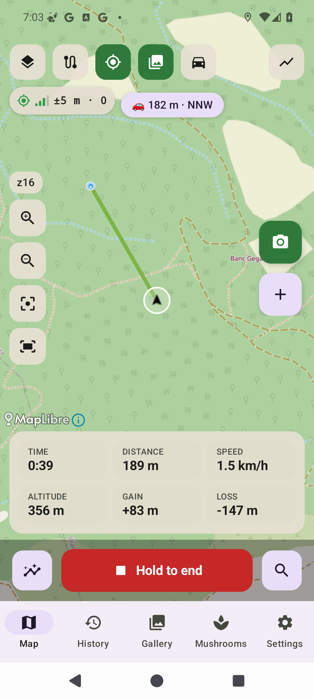 | 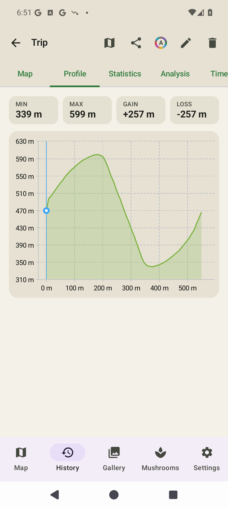 |

| **Layers** — switch between OpenStreetMap, the ICGC topographic map, the orthophoto and the hybrid view, add offline areas and enable the habitat overlays (slope orientation, tree types, soil). | **History** — every recorded trip with distance, duration, elevation and photo counts; search, filter and give each trip its own route colour. |
| 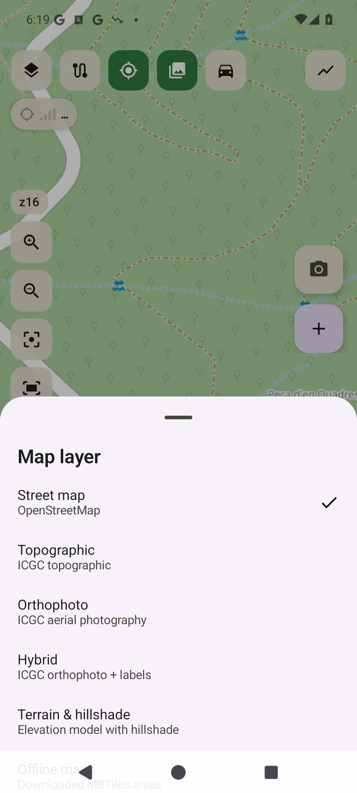 | 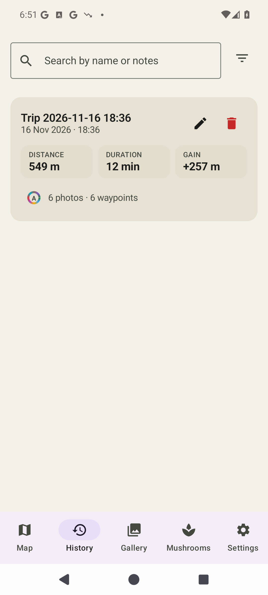 |

| **Trip review** — map with the recorded route, elevation profile, full statistics, notes and animated playback; export or load the route back on the main map. | **Outing analysis** — time moving vs stopped, pace, farthest point, loop detection, finds per hour and per altitude, daylight left and your personal ranking. |
| 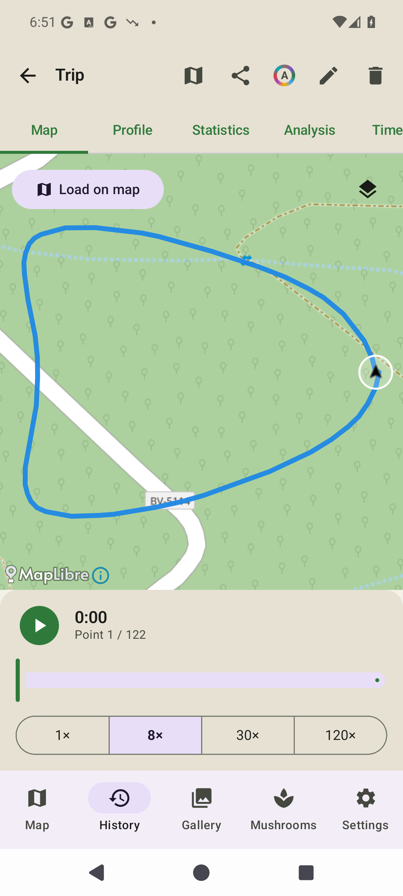 | 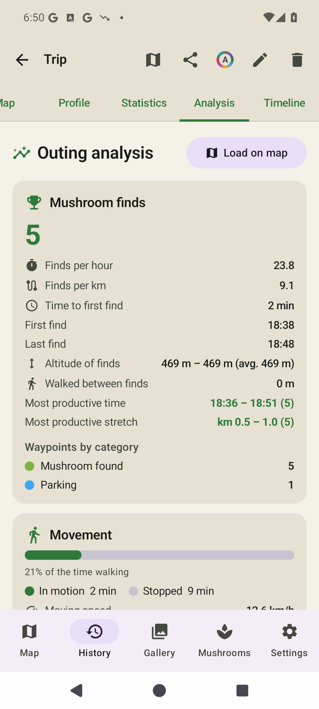 |

| **Gallery** — all geotagged waypoints as photo tiles (or category-coloured tiles when they have no photo); show one on the map, delete, share or export it with its location. | **Mushroom guide** — offline encyclopedia of popular mushrooms of Catalonia: search, *In season now* filter and per-species details. |
| 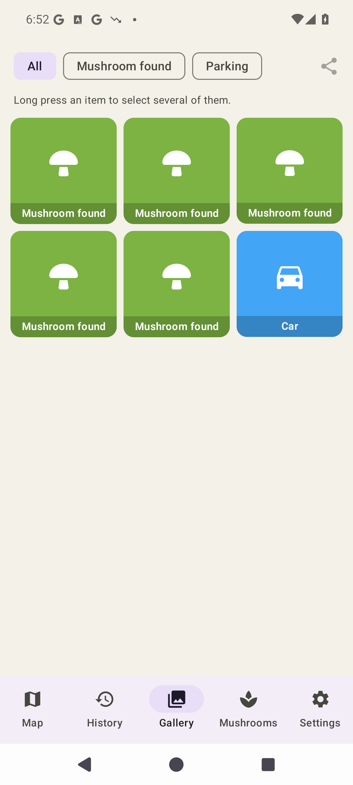 | 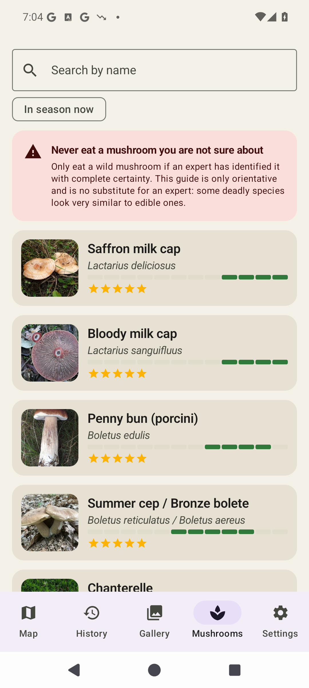 |

| **Species detail** — cooking, habitat, season calendar, dangerous look-alikes, photo galleries and a *Where can I find it?* habitat search that paints the likely areas around you on the map. | **Settings** — language, theme, units, sounds and alerts, offline map manager, GPS and sensor diagnostics and permissions. |
| 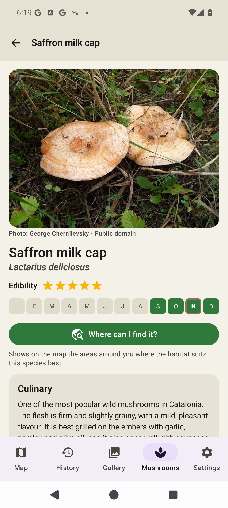 | 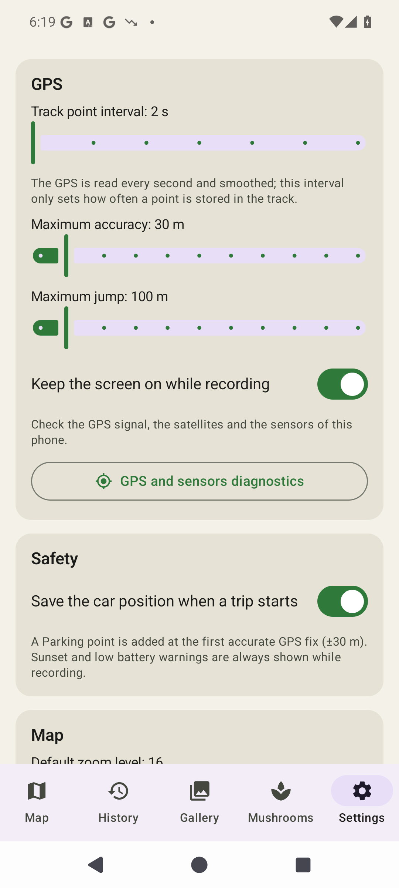 |

---

## 1. Feature overview

| Area | What it does |
| --- | --- |
| Map | Full-screen MapLibre map, live position, live route, overlaid previous routes, photograph markers, layer switcher |
| Recording | `START` / `END` controls, foreground service that keeps recording with the screen off, progressive persistence, crash recovery |
| Layers | OpenStreetMap, ICGC topographic, ICGC orthophotography, ICGC hybrid, terrain + hillshade, offline MBTiles |
| Habitat layers | Switchable overlays on top of any base map: slope orientation (north / south / east-west hatching, computed on the device from elevation tiles), dominant tree species (Mapa Forestal de España, MITECO) and soil substrate (acid / basic bedrock, IGME lithological map), with an on-map legend where every class can be shown or hidden; plus the *likely areas* of a species of the guide around the user, scored from the three of them |
| Elevation profile | Vico chart, distance on the horizontal axis, altitude on the vertical axis, tap to locate a point on the map, live position marker |
| Statistics | Elapsed time, distance, current / average / maximum speed, altitude, gain, loss, moving and stationary time, photo and waypoint counters |
| Photographs | In-application camera (CameraX), geotagged waypoints, editable description and category |
| Overlays | Any number of previous trips drawn on top of the map with a dark casing and animated "marching ants" dashes, each with its own colour (automatic or chosen in the history) and its name in a label of constant size, switched on and off from the *Routes* button. The optional *Go to route* button frames each overlaid route in turn and then returns to the user's position |
| Map long press | Marks the point and opens a menu with its coordinates and distance: *Create a waypoint here* (in the trip being recorded, or in a chosen previous trip), *Go there* (walking directions in Google Maps, or the browser / any `geo:` app) and *Copy coordinates* |
| Place search | The search button right of START opens a sheet to find a place by name (Nominatim, results with type, locality and distance), go to typed coordinates (decimal or degrees-minutes-seconds) or answer *Where am I?* (address, municipality, county, province, postcode, nearby feature, coordinates and altitude, with copy and share). The chosen place is framed and marked; the pin button also opens the long-press menu there. The button can be hidden in the settings |
| Proximity alarm | A tone, a vibration and a notification when the user comes within 15–100 m of a waypoint of an overlaid trip. It works with the screen off while recording, and while the map is visible otherwise |
| Quick logging | A *🍄 Mushroom found* action in the recording notification saves a waypoint at the current position without opening the app, also from the lock screen, with a short vibration as confirmation. Waypoint descriptions can be dictated with the system speech recognizer (microphone button) |
| Back to the car | A *Car* waypoint is saved at the first accurate fix (±30 m) of a new trip (can be turned off in *Settings → Safety*). The *Back to the car* map button and a distance/direction chip open the car waypoint with its live distance and direction; without a recording, the car of the last trip is offered for 12 h |
| Safety warnings | While recording: notifications 60 and 20 minutes before sunset (NOAA algorithm, computed on the device for the current position) and when the battery drops to 20 % and 10 %, with the distance to the car and the estimated walking time back (4 km/h, 1.3 detour factor) |
| GPS and sensors diagnostics | *Settings → GPS* or the GPS status chip on the map: signal quality (off / searching / poor / fair / good / excellent), raw last fix (accuracy, altitude, speed, bearing, update rate), satellites per constellation with a sky plot and C/N0 bar chart, compass, inclinometer with bubble level, motion and environment sensors, battery and power-saving checks, and a *Copy report* action |
| History | Full CRUD of trips, search by name and notes, filters by distance, duration, elevation, photos and date. Each trip can get its own route colour for the map (12 high-contrast colours or *Automatic*) from the colour dot of the list or the trip detail |
| Review | Map, elevation profile, detailed statistics, timeline, notes and animated route playback with speed control. *Load on map* (map button of the top bar or of the review map) overlays the trip on the main map and frames the whole route |
| Outing analysis | *Analysis* tab of the trip detail: time in motion vs stopped, moving speed, pace, filtered maximum speed (GPS spikes ignored), longest stop; altitude range, ascent/descent and steepest climb; farthest distance from the start and from the car, loop detection; mushroom finds per category, per hour and per km, time to the first find, altitude range of the finds, most productive time slot and 500 m stretch with bar charts by time and altitude; daylight left at the end (sunrise/sunset); rank among the user's trips by finds, distance and duration |
| Export | GPX, GeoJSON, KML, CSV, ZIP package, plus PNG map images, elevation profiles and visual trip reports |
| Gallery | All waypoints: photographs, and waypoints without photo as tiles in the category colour with its icon. *Show on map* overlays the trip and centres the map on the waypoint; one or several waypoints (long press to select) can be deleted with their photos after a confirmation |
| Gallery export | Share the photographs, save them to `Pictures/MikoTrack` or pack them in a ZIP with their locations (GeoJSON + CSV) |
| Offline | Areas downloaded in advance as MBTiles and served from a loopback tile server |
| Languages | English, Catalan and Spanish. Chosen in *Settings → Language* or, on Android 13+, in the system per-app language settings |
| Mushroom guide | *Mushrooms* tab: offline mini encyclopedia of 34 popular edible mushrooms of Catalonia, with photo, cooking, habitat, season calendar, dangerous look-alikes and a safety disclaimer. Search and *In season now* filter. Extra photo gallery per species and photos of the dangerous look-alikes (red frame, *Toxic* / *Not edible* badge); every photo opens in a full-screen viewer with swipe, pinch / double-tap zoom, caption, credit and licence links, share and save to *Pictures/MikoTrack*. A collapsible *Preferred trees and soils* chart shows the species' affinity for each forest type, open ground, soil substrate and slope orientation (the values used for the likely areas). Content in `app/src/main/assets/mushrooms` |

## 2. Technology stack

| Concern | Choice |
| --- | --- |
| Language | Kotlin 2.2.0 |
| UI | Jetpack Compose + Material Design 3 |
| Architecture | MVVM with a manual dependency container (`core/AppContainer`) |
| Maps | MapLibre Native for Android 13.1.0 (OpenStreetMap, ICGC, offline) |
| Location | `android.location.LocationManager` (no fused provider, no Play Services) |
| Background | Foreground service with the `location` type + WorkManager |
| Persistence | Room 2.7.2 (SQLite) + Jetpack DataStore for the settings |
| Charts | Vico 2.1.4 |
| Async | Kotlin Coroutines and Flow |
| Offline maps | MBTiles 1.3, served over a loopback HTTP server |

### Package layout

```
com.mikotrack
├── core/           GeoUtils, Formatters, permissions, app language, AppContainer
├── domain/         Models, statistics and elevation engine, GPS quality, proximity,
│                   sunset and trip safety rules
├── data/           Room entities, DAOs, database, repositories, settings, image store
├── location/       LocationManager tracker, GPS smoothing, foreground recording service,
│                   proximity alarm, safety monitor, GNSS and sensor monitors
├── maps/           Layer catalogue, style factory, overlay renderer, habitat layers,
│                   MBTiles, tile server
├── export/         GPX, GeoJSON, KML, CSV, ZIP, photo and image exporters
└── ui/             Compose screens: map, elevation, history, gallery, mushroom guide,
                    diagnostics, settings, permissions, camera
```

### Project structure

```
MikoTrack/
├── app/                    The Android application (sources, resources, unit tests)
│   ├── schemas/            Room database schemas, used to check the migrations
│   ├── offline-assets/     Offline map packs of Catalonia (gitignored; debug builds only)
│   └── src/main/assets/
│       └── mushrooms/      Mushroom guide: species, texts per language, photographs
├── gradle/                 Gradle wrapper and version catalogue
├── resources/              Brand artwork (logo, banner) in full resolution
└── tools/                  Scripts that build the offline map packs
```

## 3. Building the application

Requirements:

* JDK 17 or newer
* Android SDK with platform 36 and build tools 36.x

```bash
# The SDK location, if ANDROID_HOME is not set
echo "sdk.dir=/path/to/Android/Sdk" > local.properties

./gradlew assembleDebug        # build the debug APK
./gradlew test                 # run the unit tests
./gradlew installDebug         # install on a connected device
```

The application requires **no API keys**. `local.properties` is the only local configuration.

### Release signing

Release builds are signed automatically when a `keystore.properties` file exists next to
the top-level `settings.gradle.kts`; without it the release APKs stay unsigned. This file
is gitignored and must never be committed:

```properties
storeFile=mikotrack-release.keystore
storePassword=…
keyAlias=mikotrack-release
keyPassword=…
```

Create the keystore once with (`keytool` ships with the JDK):

```bash
keytool -genkeypair -keystore mikotrack-release.keystore -alias mikotrack-release \
    -keyalg RSA -keysize 2048 -validity 10950 -storepass … -dname "CN=MycoTrack, …"
```

Keep a safe backup of `mikotrack-release.keystore` and its password: without them it is
impossible to publish updates that replace an already installed version.

```bash
./gradlew assembleRelease      # signed APKs, in app/build/outputs/apk/release/
```

Install the universal or per-ABI APK on any device (Android 8.0 / API 26 or newer) with
`adb install`, or by copying it to the device and allowing installs from unknown sources.

### Permissions

| Permission | Why it is needed |
| --- | --- |
| `ACCESS_FINE_LOCATION` / `ACCESS_COARSE_LOCATION` | Reading the GPS position |
| `ACCESS_BACKGROUND_LOCATION` | Continuing the recording with the screen off |
| `FOREGROUND_SERVICE` / `FOREGROUND_SERVICE_LOCATION` | The recording foreground service |
| `POST_NOTIFICATIONS` | The ongoing recording notification |
| `CAMERA` | Taking the geotagged photographs in the application |
| `INTERNET` / `ACCESS_NETWORK_STATE` | Downloading map tiles and elevation data |

## 4. Map sources and attribution

The base layers are described in `maps/MapLayer.kt` and can be replaced or extended
without touching the rest of the application.

| Layer | Source | Attribution |
| --- | --- | --- |
| Street map | `tile.openstreetmap.org` | © OpenStreetMap contributors (ODbL) |
| Topographic | ICGC `mapa-base` WMTS, `topografic` | © Institut Cartogràfic i Geològic de Catalunya |
| Orthophoto | ICGC `mapa-base` WMTS, `orto` | © Institut Cartogràfic i Geològic de Catalunya |
| Hybrid | ICGC `mapa-base` WMTS, `orto-hibrida` | © Institut Cartogràfic i Geològic de Catalunya |
| Terrain and hillshade | Terrarium elevation tiles | © Mapzen / OpenStreetMap contributors |
| Offline | MBTiles downloaded by the application | Stored on the device |

The place search uses the Nominatim geocoder (`nominatim.openstreetmap.org`, © OpenStreetMap
contributors), at most one request per second, only when the user submits a search.

### Habitat overlays

Three optional overlays (*Layers → Habitat layers*) are drawn above any base map and below
the routes, waypoints and position, from bottom to top: soil, tree types and slope
orientation (plus, on top, the likely areas of a species, described below). They need an internet connection; offline they stay empty. A collapsible
legend (*Habitat legend* chip) appears on the map while one of them is on: it has one
collapsible section per overlay with *All* / *None* shortcuts and a checkbox per class, so
only the classes of interest are drawn. The choices are stored in the settings.

| Overlay | Source | Attribution / licence |
| --- | --- | --- |
| Slope orientation | Computed on the device from the Terrarium elevation tiles (zoom 10–15; zoom 16–18 reuse the zoom 15 classes) and served by the loopback tile server at `/aspect/{z}/{x}/{y}.png?c=ns` | Elevation © Mapzen / OpenStreetMap contributors |
| Tree types | MITECO WMS `https://iepnb.gob.es/geoserver/foto_fija_mfe/wms`, layer `ff_form_arbolada` (Mapa Forestal de España 1:25.000, dominant forest formation), requested in EPSG:3857 as transparent 512 px PNGs | Mapa Forestal de España © MITECO, CC BY 4.0 |
| Soil (substrate) | IGME WMS `https://mapas.igme.es/gis/services/Cartografia_Geologica/IGME_Litologias_1M/MapServer/WMSServer`, layer `0` (Mapa litológico de España 1:1.000.000), requested in EPSG:3857 as 256 px PNGs by the loopback tile server and recoloured at `/soil/{z}/{x}/{y}.png?m=<mask>` (zoom 6–12, over-zoomed beyond) | Mapa litológico de España © IGME-CSIC, CC BY 4.0 (free service; the IGME asks to be contacted before building a paid value-added service on it) |

**Orientation.** The orientation of every pixel is derived with Horn's 3×3 gradient
(using the neighbouring elevation tiles for the border) and classified as north-facing
(±45°), south-facing (±45°) or east/west; slopes under 4° are left out
(`maps/AspectClassifier.kt`). The classes are drawn as textures instead of solid fills, so
the tree and soil colours stay visible underneath (`maps/AspectHatch.kt`): blue `////`
lines for north, orange `\\\\` lines for south and a sparse grid of dots for east/west
(off by default). The patterns are computed from global pixel coordinates
(`tileX × 256 + x`, `tileY × 256 + y`), so they are continuous across tile borders and keep
the same on-screen spacing at every zoom level. The selected classes travel in the `c`
query parameter (`n`, `s`, `e`); a new selection gives a new URL, so MapLibre reloads the
source. The class grids and the drawn tiles (one folder per selection) are cached.

**Tree types.** The legend is hand-made from the colours of the `form_arbolada` style
(checked against the service's SLD and `GetLegendGraphic`) and lists the formations found
in Catalonia with their `id_supraforarb` codes (checked with WFS queries). When some are
unchecked, the URL gets a GeoServer filter such as
`&CQL_FILTER=id_supraforarb%20IN%20(1,18)`, so the server only draws those formations;
with all of them checked no filter is sent. The map is shown from zoom 7.

**Soil.** Many mushrooms are linked to the substrate: chanterelles and many boletes
prefer acid (siliceous) soils, others limestone. The IGME lithological map is coarse
(1:1,000,000) but covers Catalonia continuously with 24 explicit lithologies, which the
app groups as *acid / siliceous* (granite, gneiss, migmatite, slate, greywacke, quartzite,
felsic volcanic rocks), *basic / calcareous* (limestone, dolomite, marl, calcarenite and the
calcareous Tertiary basin series with evaporites) and *mixed or other* (Triassic and
Palaeozoic mixed series, schists with marble, river deposits, volcanic and ultramafic
rocks). The service does not allow restyling, so the loopback server downloads the
original tiles (cached as they are), matches every pixel to the nearest style colour
(antialiased border pixels take the class of a neighbour) and draws it with the colour of
its group, leaving the unchecked lithologies transparent (`maps/SoilClassifier.kt`). The
`m` query parameter is the hexadecimal bit mask of the visible lithologies.

**Likely areas of a species (*Zones probables*).** In the detail of a species of the
mushroom guide, *Where can I find it?* asks for the centre of the search (*My position* or
*Centre of the map*, the point the main map is centred on) and a radius (1, 2, 5, 10, 20 or
50 km; it warns when the species is out of season) and opens the map framed on that circle
(with *My position* and no fix yet, the centre of the map is used). A fourth overlay, drawn
on top of the other three, colours the places inside the circle whose habitat suits the
species: transparent below a score of 0.4, then yellow → magenta → purple with increasing
opacity, and a dashed purple border on the circle. It is listed in *Layers → Habitat
layers* (enabled once a species has been chosen) and has its own legend section with the
species, the radius, the colour ramp, a switch and *Remove*. The search is stored in the
settings.

The loopback server computes every tile (`/suitability/{z}/{x}/{y}.png?s=<species>&la=<lat>&lo=<lon>&r=<metres>`,
zoom 7–16, over-zoomed beyond; the large circles are computed coarsely at low zoom) from the same tile of the three other sources: the
orientation classes, the IGME lithologies grouped as acid / basic / other, and the MITECO
forest map (requested unfiltered at 256 px and matched pixel by pixel to the colours of
the tree legend; transparent means no forest). `maps/SuitabilityScorer.kt` combines them
with the affinities of the species (`habitat` in `species.json`, from 0 to 1) on a
128 × 128 grid, interpolated bilinearly to 256 px:

- score = weighted mean of the tree (0.5), soil (0.25) and orientation (0.25) affinities;
  a factor the species has no affinities for is left out and the weights renormalised;
- a known tree affinity of 0 (another formation, or no forest for a species that does not
  list the `none` key) makes the score 0;
- unlisted classes and unknown inputs (a source that failed, a pixel outside the source
  map) count as a neutral 0.5, so the overlay still works, less sharply, when one source
  is down; flat terrain takes the east/west affinity.

Everything the tiles depend on is in the URL, so a new search reloads the source. The
source tiles are cached with the other habitat tiles; the drawn tiles are cached per
species, affinities and circle only when every input was available. At most three tiles
are computed at a time, on threads of their own. **Limitations:** the result is only an
indication of favourable habitat, not of where mushrooms are; it depends on the two online
WMS (empty or neutral offline), the soil map is very coarse (1:1,000,000), and the
affinities are generic for Catalonia (no altitude, weather or recent rain).

All the habitat tiles live in the cache directory (about 150 MB at most).

**Habitat at a point.** While a habitat layer is on, long-pressing the map adds a
*Habitat at this point* section to the point sheet with the value of every visible layer
there (`HabitatPointInspector`, `HabitatPointSection`): the orientation class, the
direction the slope faces, the slope (% and °) and the altitude, from Horn's gradient on
the zoom 15 elevation tile; the forest formation, its main species with their share and
the canopy cover, from a WMS `GetFeatureInfo` request to the MITECO map
(`INFO_FORMAT=application/json`, only the needed `PROPERTYNAME`s; an empty answer is asked
again once because the service is sometimes inconsistent, and the colour of a 3 × 3 px
`GetMap` is the fallback when there is no usable answer); the lithology and its substrate
group, from `GetFeatureInfo` on the IGME service (`INFO_FORMAT=text/xml`); and, with the
likely areas on, the score of the species there (low / medium / high). Every value is
fetched off the main thread with an 8 s timeout and abandoned when the sheet closes.

The ICGC data is published under CC BY 4.0; please consult the
[ICGC open data catalogue](https://openicgc.github.io/) for the exact terms of use before
redistributing the tiles. The OpenStreetMap tile usage policy
([operations.osmfoundation.org/policies/tiles](https://operations.osmfoundation.org/policies/tiles/))
applies to the street layer: use a dedicated tile server for heavy usage.

## 5. Offline maps

`maps/OfflineMapManager` downloads the tiles of a bounding box into a standard **MBTiles**
file (SQLite with a `tiles` table, TMS row convention). `maps/LocalTileServer` exposes the
stored tiles through a small HTTP server bound to `127.0.0.1`, and MapLibre reads them
through a raster source that points at that server. The result is a fully offline map that
does not depend on any external service and that can be deleted at any time from
*Settings → Offline maps*.

### Bundled packs

The two Catalonia packs are **not stored in this repository** (they are too large for
GitHub). They live in `app/offline-assets/offline/`, which is gitignored and wired as an
extra asset directory for **debug builds only**, so a debug APK ships them inside the APK
and copies them to the private storage on the first start: the ICGC orthophoto (zoom
10–13, 256 px JPEG tiles) and the ICGC topographic map (zoom 10–12, 512 px tiles).
Release APKs do not contain them and the offline map areas have to be downloaded on the
device; a release build simply skips seeding the missing packs. To (re)create the packs,
use the scripts in `tools/` (Python 3 and Pillow):

```bash
pip install pillow
python tools/build_offline_pack.py --layer ORTO --min-zoom 10 --max-zoom 13 \
    --out app/offline-assets/offline/catalonia_ortho.mbtiles
python tools/finalize_offline_pack.py app/offline-assets/offline/catalonia_ortho.mbtiles --tile-size 256

python tools/build_offline_pack.py --layer TOPO --min-zoom 10 --max-zoom 12 \
    --out app/offline-assets/offline/catalonia_topo.mbtiles
python tools/finalize_offline_pack.py app/offline-assets/offline/catalonia_topo.mbtiles --tile-size 512
```

The build is resumable. The finalisation step merges the write-ahead log into the file,
so no `-wal`/`-shm` sidecars end up in the APK. If the zoom range or the tile count
changes, update `OfflineMapManager.BUNDLED_PACKS` accordingly.

## 6. Data model

| Table | Columns |
| --- | --- |
| `trips` | `id`, `name`, `startTime`, `endTime`, `durationMillis`, `distanceMeters`, `elevationGain`, `elevationLoss`, `minAltitude`, `maxAltitude`, `notes`, `status`, `photoCount`, `waypointCount`, `lastUpdated` |
| `track_points` | `id`, `tripId`, `latitude`, `longitude`, `altitude`, `accuracy`, `speed`, `bearing`, `timestamp` |
| `waypoints` | `id`, `tripId`, `latitude`, `longitude`, `altitude`, `timestamp`, `description`, `category`, `imagePath` |
| `waypoint_categories` | `id`, `name`, `color`, `symbol`, `builtIn` |
| `offline_areas` | `id`, `name`, `layerId`, `filePath`, bounds, zoom range, `tileCount`, `sizeBytes`, `createdAt` |

Foreign keys use `ON DELETE CASCADE`, so deleting a trip also removes its track and its
waypoints; the photographs are deleted from the file system by `ImageStore`.

## 7. Third-party dependencies and licences

All dependencies are free and open source.

| Dependency | Version | Licence |
| --- | --- | --- |
| Jetpack Compose / Material 3 | BOM 2025.06.01 | Apache 2.0 |
| Jetpack Navigation Compose | 2.9.5 | Apache 2.0 |
| Jetpack Lifecycle | 2.9.4 | Apache 2.0 |
| Jetpack Activity Compose | 1.10.1 | Apache 2.0 |
| Jetpack DataStore | 1.1.7 | Apache 2.0 |
| Jetpack WorkManager | 2.10.5 | Apache 2.0 |
| Room | 2.7.2 | Apache 2.0 |
| CameraX | 1.4.2 | Apache 2.0 |
| ExifInterface | 1.4.1 | Apache 2.0 |
| MapLibre Native for Android | 13.1.0 | BSD-2-Clause |
| MapLibre Android plugins | 4.0.0 | BSD-2-Clause |
| Vico | 2.1.4 | Apache 2.0 |
| Coil | 2.7.0 | Apache 2.0 |
| Kotlin Coroutines | 1.10.2 | Apache 2.0 |
| kotlinx.serialization | 1.9.0 | Apache 2.0 |
| Robolectric (test only) | 4.14.1 | Apache 2.0 |
| JUnit (test only) | 4.13.2 | EPL 1.0 |

### Photo credits

The photographs of the mushroom guide come from Wikimedia Commons and are used under free
licences (public domain, CC BY and CC BY-SA). The author, the licence and a link to the
original file of every photograph are shown under it in the detail screen of each species,
and are listed in `app/src/main/assets/mushrooms/species.json`. The main images were resized to
800 px or less, and the gallery and look-alike photographs (`<species>_gN.jpg`, `la_<species>.jpg`)
to 720 px and about 90 KB or less.

## 8. Tests

The unit tests cover the parts that carry the domain logic and can be verified without a
device:

* `GeoUtilsTest` – distances and bearings.
* `TripStatsCalculatorTest` – distance, elevation gain and loss, moving time, the elevation
  profile and the interpolation of the altitude.
* `GpsTrackSmootherTest` – the smoothing and the rejection of GPS outliers.
* `WaypointDistanceCalculatorTest` – distance, direction and distance along the route to a waypoint.
* `ProximityMonitorTest` – when the proximity alarm rings and when it is armed again.
* `SunCalculatorTest` and `TripSafetyTest` – sunset times and the sunset / battery warnings.
* `GpsQualityTest` – the rating of the GPS signal.
* `ExporterTest` – the GPX, GeoJSON, KML and CSV documents are parsed back as XML / CSV.
* `TileMathTest`, `MbtilesStoreTest`, `OfflineMapPackTest` – tile maths, MBTiles files and
  the bundled packs.
* `AspectClassifierTest` – slope orientation (aspect) and its north / south / neutral / flat classes.
* `HabitatPointInspectorTest` – parsing of real `GetFeatureInfo` answers of the forest and
  lithological maps, and the orientation / slope at a point of an elevation grid.
* `PermissionRequirementTest` – every permission explains itself in the three languages.
* `MushroomCatalogTest` – the mushroom guide data is complete in the three languages, with credited photos, captioned and freely licensed gallery and look-alike photos (consistent with the look-alike texts) and valid habitat preferences.
* `CoordinateParserTest` – decimal, degrees-minutes-seconds and hemisphere coordinates typed by the user.
* `GeocoderTest` – Nominatim search / reverse answers and request URLs.

```bash
./gradlew test
```

## 9. Notes and limitations

* The application is designed for the use case described in the specification: a trip that
  is recorded in the forest, reviewed days later and exported.
* The background location permission has to be granted from the system settings on recent
  Android versions; *Settings → Permissions* links to the system screen.
* The ICGC layers cover Catalonia. Outside that area the OpenStreetMap and terrain layers
  are the ones with coverage.
* A recorded trip is persisted point by point, so an unexpected termination never loses
  the data; the map screen offers to resume the interrupted trip.
